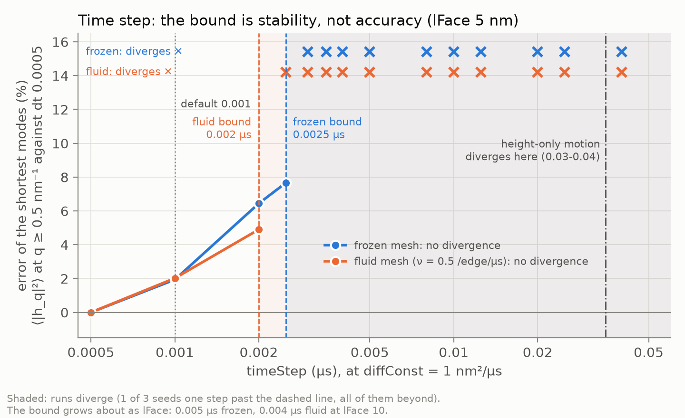
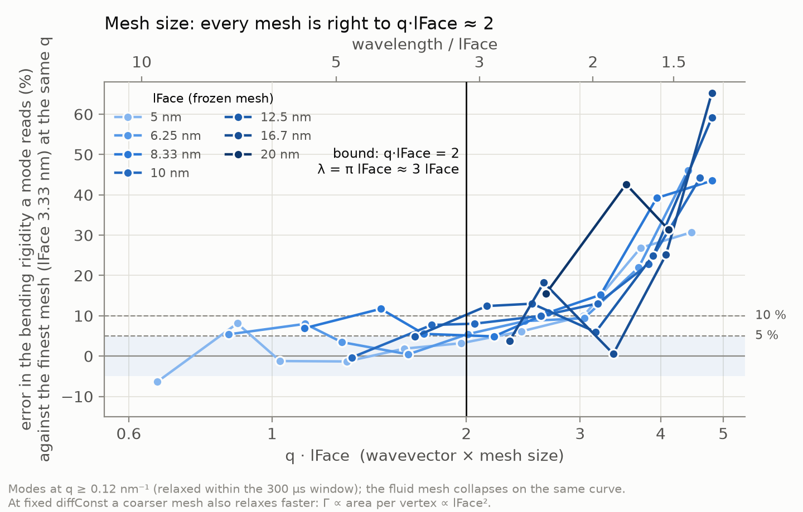
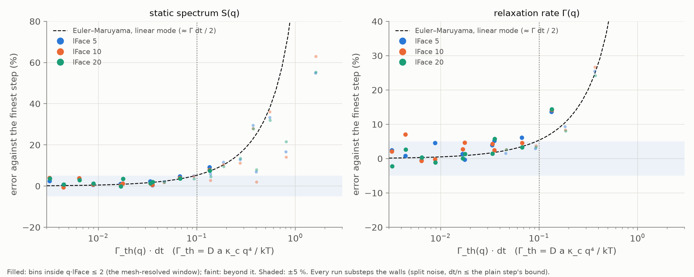

# How coarse can a run be? Time step and mesh size

**Runs:** 2026-10-16/17, 110 runs, `~/slimed_runs/resolution` (summaries only), cluster copy
`slimed/resolution`. Generated by `analysis/resolution_sweep_runs.py` (`--set sweep`, `stability`,
`replicas`); reduced on the cluster with `analysis/resolution_sweep_analysis.py reduce <run>` and
compared with `analysis/resolution_sweep_analysis.py report <root> --extra <flat_tension>/box_frozen
<flat_tension>/box_nu0.5`, which writes `stats.md` and the figures to `<root>/analysis` (not tracked).
The dt = 0.001, lFace = 5 point is the 600 µs `flat_tension` pair of `docs/flat_tension_matrix.md`.

The sheet is the flat periodic tile of `docs/flat_tension_matrix.md` with no bead: about 100 nm on a
side, κ_c = 83.4 pN·nm, K = 250 pN/nm, D = 1 nm²/µs, the elastic box at τ = 0, the fluid-mesh terms
on (tether [0.7, 1.75] lFace, altitude floor, crease wall), frozen or with flips at ν = 0.5 per edge
per µs. Every run is 400 µs with a frame every 0.2 µs, and every statistic is taken over 100-400 µs.

## 1. The answer

| | frozen mesh | fluid mesh (ν = 0.5) |
| --- | --- | --- |
| largest dt with no divergence in 1200 µs (3 seeds), lFace 5 | **0.0025 µs** | **0.002 µs** |
| same, lFace 10 (one or two seeds of 400 µs) | 0.005 µs | 0.004 µs |
| lFace 20 | below 0.008 µs (2 of 3 seeds diverge there; nothing run between 0.001 and 0.008) | below 0.008 µs (1 of 2) |
| static error at that dt, lFace 5 | zone-edge modes +8 %, κ_c window +3 % | +5 %, +4 % |
| largest lFace for a wavelength λ, ≈ 5 % error | λ ≥ 3 lFace (q·lFace ≤ 2) | same |
| same, ≈ 10 % error | λ ≥ 2.5 lFace (q·lFace ≤ 2.5) | same |

The time step is limited by **stability, not accuracy**: below the step at which runs start to
diverge, the spectrum is off by a few per cent at most. The default dt = 0.001 sits a factor of 2
(fluid) to 2.5 (frozen) under the bound at lFace 5.

**With the walls substepped (`meshForceSubsteps`, section 2.6) that changes:** the stability bound
moves out to the height-only one, 0.03 (lFace/5)² µs, and the step is limited by accuracy instead.
S(q) and Γ(q) stay within 5 % across the mesh-resolved window q·lFace ≤ 2 up to
dt ≈ 0.01 (lFace/5)² µs (0.01, 0.04, 0.16 µs at lFace 5, 10, 20; about 0.005 µs fluid at lFace 5),
2.4-3.2x the throughput of the plain step at its bound. Section 2.6.5 has the table.

The mesh size is limited by the **shortest wavelength that matters**: every mesh reads the same
spectrum, mode by mode, as long as q·lFace ≲ 2. Coarsening at fixed `diffConst` also makes the
membrane faster in physical time (section 3.2).

Both figures are drawn by `analysis/resolution_limit_figures.py <runs root> docs/figures` from the
run summaries.

## 2. The time step

### 2.1 Divergence comes at a random time

Too large a step does not give a slowly worsening answer: the run diverges, at a moment that varies
from seed to seed, and sooner the larger the step. So the seeds of one setting are pooled into a rate,
divergences per ms of simulated time (the 95 % upper limit 3/T when there were none):

| lFace | flips | dt (µs) | seeds | diverged | simulated (µs) | per ms | diverged at (µs) |
| --- | --- | --- | --- | --- | --- | --- | --- |
| 5 | frozen | 0.0025 | 3 | 0 | 1200 | < 2.5 | |
| 5 | frozen | 0.003 | 3 | 1 | 1011 | 1.0 | 211 |
| 5 | frozen | 0.0035 | 1 | 1 | 24 | 42 | 23.6 |
| 5 | frozen | 0.005 | 1 | 1 | 3 | 320 | 3.1 |
| 5 | frozen | ≥ 0.008 | 1 each | all | | | within 25 steps |
| 5 | fluid | 0.002 | 3 | 0 | 1200 | < 2.5 | |
| 5 | fluid | 0.0025 | 3 | 1 | 1114 | 0.9 | 314 |
| 5 | fluid | 0.003 | 3 | 3 | 135 | 22 | 11, 13, 111 |
| 5 | fluid | 0.0035-0.005 | 1 each | all | | 500-900 | 1-2 |
| 10 | frozen | 0.005 | 1 | 0 | 400 | < 7.5 | |
| 10 | frozen | 0.006 | 3 | 1 | 849 | 1.2 | 48.9 |
| 10 | frozen | 0.007 | 2 | 2 | 78 | 26 | 17, 61 |
| 10 | fluid | 0.004 | 2 | 0 | 800 | < 3.8 | |
| 10 | fluid | 0.006 | 2 | 2 | 99 | 20 | 42, 58 |
| 20 | frozen | 0.008 | 3 | 2 | 595 | 3.4 | 52, 143 |
| 20 | frozen | 0.01 | 2 | 2 | 187 | 11 | 78, 109 |
| 20 | fluid | 0.008 | 2 | 1 | 600 | 1.7 | 200 |

The fluid mesh is the more fragile at every step. The rate climbs by more than an order of magnitude
per 20 % of step, so the boundary is sharp in dt even though each run's fate is random -- but a
setting quoted as safe here is safe for about a millisecond, not indefinitely: for runs much longer
than that, stay a step below.

### 2.2 The in-plane motion sets the bound, not bending

The height-only dynamics (`inPlaneDynamicsEnabled = false`, no mesh terms) on the same sheet:

| lFace | stable to (µs) | diverges at |
| --- | --- | --- |
| 5 | 0.03 | 0.04 |
| 10 | 0.12 | 0.16 |

That limit grows as lFace², as it should for an explicit step on bending, whose fastest mode relaxes
at Γ_max ∝ D a κ_c q_max⁴ ∝ lFace⁻²; and 2/Γ_max ≈ 0.035 µs at lFace 5 gives Γ_max ≈ 60 µs⁻¹, the
same rate that sets the zone-edge bias of section 2.3. The full dynamics diverges at a 12× smaller
step at lFace 5, and its bound grows only about as lFace (0.0025, 0.005, < 0.008 at 5, 10, 20).

Switching the mesh terms off one at a time (frozen, lFace 5, dt 0.004 / 0.005 / 0.008):

- the crease wall off, the altitude floor at a quarter of its stiffness, or the floor and the tether
  both at a quarter: no help. The first two diverge at the *same step* as the default (6741-6743 at
  dt 0.004, 619 at 0.005: the noise is counter-based, so the same kick sets it off);
- the altitude floor off: diverges within 50 steps at every dt;
- every mesh term off: diverges later (16-69 µs) but at all three steps, including 0.008;
- the elastic box off (fixed box): no help.

Just before a run goes, the mesh-term energy jumps from its usual 300-800 to 3400 pN·nm in one step
(`dt0.004_frozen`, step 6736) and then grows 2-3×
per step while the bending energy is still normal: an explicit-step instability, with a stiffness of
about 3600 pN/nm (D k dt / kT ≈ 3.5). A plausible reading, not proven: the step displaces the limit
surface S = M C, so a control point moves by M⁻¹ times the step, and the valence-6 limit mask
(1/2, six times 1/12) has symbol 1/4 at the zone corner. The mobility seen by any force on the control
points -- the mesh terms are such forces -- is up to 16× D/kT there, and two of the 83.4 pN/nm walls
pressing on one vertex are already enough at dt 0.004. Softening the walls lets the vertex penetrate
further, which is why it did not help. Bending is computed on the limit surface and does not see the
factor. Section 2.6 confirms the reading: integrating only the walls in substeps of the plain step's
size removes the divergence up to the height-only bound.

### 2.3 Below the bound the error is small

Spectrum against dt = 0.0005 (`dt_frozen.png`, `dt_nu0.5.png`), lFace 5, seeds pooled:

| flips | dt (µs) | ⟨\|h_q\|²⟩ at q ≥ 0.5 nm⁻¹ | at 0.12-0.31 nm⁻¹ | E_bend / kT | κ_c fit | MSD at 10 µs | flips / µs |
| --- | --- | --- | --- | --- | --- | --- | --- |
| frozen | 0.0005 | 1 | 1 | 258.9 | 85.7 ± 1.8 | 6.99 | |
| frozen | 0.001 | 1.019 | 1.026 | 262.7 | 81.2 ± 2.7 | 7.02 | |
| frozen | 0.002 | 1.064 | 1.021 | 267.2 | 80.2 ± 2.2 | 6.89 | |
| frozen | 0.0025 | 1.077 | 1.026 | 270.8 | 78.6 ± 0.5 | 6.80 | |
| frozen | 0.003 | 1.093 | 1.032 | 275.0 | 76.2 ± 0.8 | 6.69 | |
| fluid | 0.0005 | 1 | 1 | 260.3 | 85.5 ± 4.3 | 11.28 | 124 |
| fluid | 0.001 | 1.020 | 1.043 | 265.8 | 85.4 ± 3.8 | 11.24 | 122 |
| fluid | 0.002 | 1.049 | 1.036 | 271.1 | 81.8 ± 4.5 | 11.26 | 123 |
| fluid | 0.0025 | 1.072 | 1.027 | 275.4 | 84.5 ± 4.1 | 11.03 | 122 |

The zone-edge modes read high by ≈ 3 % per 0.001 µs of step, linearly: the Γ dt / 2 excess variance
of an Euler-Maruyama step on a mode of rate Γ ≈ 60 µs⁻¹. Inside the κ_c fit window the excess is
2-4 % at every dt (within the reference's own noise), the in-plane MSD changes by at most 4 %, and the
flip rate and acceptance (0.29) not at all. The relaxation rates the frames can time (q < 0.27 nm⁻¹,
Γ dt < 0.01) do not move. The frozen κ_c fit drifts from 86 to 76 across the range and the fluid one
does not; the fit leans on the slowest modes, whose seed-to-seed scatter is larger than either
trend (at dt 0.002 the three fluid seeds give κ_c 86, 87, 73 and σ_spec +0.35, +0.38, +0.95), so the
fit is not the place to look for a dt effect.

### 2.4 Only D·dt matters

The membrane update is `(D dt / kT) F + sqrt(2 D dt) ξ`, so every bound above is a bound on D·dt with
D = 1 nm²/µs: at another `diffConst` divide by D. The box (`elasticBoxMobility`), the lipid reservoir
and the flip attempt rate carry their own clocks and do not rescale; the box warns at rate·dt above 1
and sits at 0.01 at dt 0.001.

### 2.6 Substepping the walls (`meshForceSubsteps`)

**Runs:** 2026-10-20/21, `~/slimed_runs/mts` (lFace 5, the 100 nm tile, 346 runs) and
`~/slimed_runs/substep_res` (lFace 5, 10, 20 on a tile 20 faces across, 286 runs), generated by
`analysis/substep_resolution_runs.py` and reduced and compared by
`analysis/substep_resolution_report.py reduce | report` (which writes `report.md` beside the runs).

#### 2.6.1 What it does

Section 2.2 left the bound on the walls: the edge tether, the altitude floor and the crease wall act on
the control points, see a mobility of up to 16 D/kT at the zone corner, and an explicit step through
them overshoots. Confirmed: at the onset of the forensic divergence (dt 0.004, step 6734) the force
step on one vertex jumps from 0.3 to 1.3 nm while its noise step is 0.2 nm; the face inverts the next
step. Truncating the noise does not help (it is not a tail kick).

`meshForceSubsteps = n > 1` integrates the walls -- and only the walls -- in n Euler substeps of dt/n
per Brownian step. `next_step()` takes bending, area, the bead and 1/n of the wall force as before;
`DynamicModel::mesh_force_substeps()` then re-evaluates only the walls for the other n - 1 substeps,
each through the full step's pipeline (S = M C, F_S = M⁻ᵀ F, the move, the mean-height pin,
C = M⁻¹ S, the images re-asserted). The walls are sums over the edge table, cheap next to the patch
kernels. Off (n = 1, the default) the shipped arithmetic is untouched: the legacy periodic and Mixed
frozen gate workloads are byte-identical.

`meshForceSubstepNoise` says where the noise goes:

- `split` (default): √(2 D dt / n) on every substep, keyed per substep. The sum is one Gaussian of
  variance 2 D dt, so each bending mode receives the shipped step in law, and every wall substep is a
  true Euler-Maruyama step of dt/n.
- `once`: the shipped single draw on the first substep. The other n - 1 substeps relax every wall
  violation without refreshing it, so at the step boundary -- where frames and energies are taken --
  the walls are sampled too cold: wall energy 82 pN·nm at dt 0.004, n 2 (55 at 0.005, 20 at 0.008 n 8)
  against 262 at dt 0.0005; split gives 297 (n 2) and 260 (n 4), the plain step's value at the
  substep size. Once also shifts the long waves (S +4-5 %, Γ −4.5 % at q 0.12-0.3 nm⁻¹) and needs
  ~2x the substeps to be stable. Do not use it.

At a fixed step the substeps change nothing measurable: at dt 0.0025, lFace 5, split n 2 against the
plain step (3 + 3 seeds of 400 µs) reads S 0.996 ± 0.005, 0.993 ± 0.002, 0.991 ± 0.014 in q 0.12-0.3,
0.3-0.6, 0.6-1.0 nm⁻¹ and Γ 1.007 ± 0.016.

Cost, serial Release, the 20 x 24 tile: one frozen step 3.08 ms, each extra substep 0.72 ms
(n = 2, 4, 8, 16: 3.72, 5.37, 8.43, 14.3 ms). With flips a step is ~27 ms and the substeps do not
show (27 ms at n = 1, 2, 4).

#### 2.6.2 Stability: the walls need dt/n under their own bound, bending needs dt under its

With the walls substepped the two limits separate. The walls need the substep dt/n under the plain
step's bound, which grows slowly with lFace; bending needs the full step under the height-only
bound of section 2.2, which grows as lFace².

The plain step on the 20-face tile (`prescan`, 8 seeds x 40000 steps):

| lFace | stable | diverging |
| --- | --- | --- |
| 5 | 0.0025 µs (section 2.1) | 0.003 µs, 1.0 per ms |
| 10 | 0.005 µs (1 of 8 seeds, 0.6 per ms) | 0.006 µs, 7 per ms; 0.007, 62 per ms |
| 20 | 0.006 µs (0 in 1.9 ms) | 0.008 µs, 4 per ms; 0.01, 44 per ms |

With split substeps, n = ceil(dt / dt_sub), dt_sub = 0.0025, 0.004, 0.006 µs (8 seeds, 100 µs x
(lFace/5)² each, `stab`):

| lFace | dt (µs) | n | diverged | simulated |
| --- | --- | --- | --- | --- |
| 5 | 0.005, 0.01, 0.02, 0.03 | 2, 4, 8, 12 | 0 at each | 0.8 ms each |
| 10 | 0.02, 0.04, 0.08, 0.12 | 5, 10, 20, 30 | 0 at each | 3.2 ms each |
| 20 | 0.08, 0.16, 0.32 | 14, 27, 54 | 1, 2, 0 (+1, 0, 1 in the 400 µs-scaled spectrum runs) | 12 ms each |
| 20 | 0.48 | 80 | 8 of 8 within 3 steps | |
| 20, dt_sub 0.005 (16 seeds, `confirm`) | 0.08, 0.16, 0.32 | 16, 32, 64 | 0 at each | 25.6 ms each |

At lFace 20 a substep of 0.006 µs is marginal -- about one divergence per 10⁵ steps, the same
per-step rate as the plain step at 0.003 µs at lFace 5 -- and 0.005 µs removes it (0 in 560k steps). The full step
then goes to the height-only bound: 0.03 µs at lFace 5 (that bound is 0.03-0.04), 0.12 at lFace 10
(0.12-0.16), 0.32 at lFace 20, where 0.48 = 0.03 (20/5)² is just over it. In D·dt / lFace² the
stable step is **0.03 (lFace / 5)² µs**, 12x (lFace 5) to 50x (lFace 20) the plain step's.

Fluid (lFace 5, ν = 0.5, 8 seeds x 40 µs): split n = 2 at dt 0.004 and 0.005, n = 4 at 0.008 and
0.01, n = 8 at 0.02: no divergence (320 µs each); the plain step at 0.004 diverges 8 of 8 (409 per
ms), and n = 2 at 0.006 (substep 0.003, past the fluid mesh's own bound of section 2.1) 4 of 8. The
fluid substep bound is 0.0025 µs at lFace 5; lFace 10 and 20 were not run with flips.

#### 2.6.3 Accuracy: Γ(q) dt sets it, the same at every lFace

Stable is no longer accurate. The walls are now integrated finely, but bending still takes the full
Euler-Maruyama step, and a linear mode of rate Γ stepped that way has its variance raised by
1/(1 - Γ dt/2) and its measured decay rate by -ln(1 - Γ dt)/(Γ dt): both ≈ **Γ dt / 2**. With the
free-draining rate of section 3.2, Γ(q) = D a κ_c q⁴ / kT (a = (√3/2) lFace², the area per vertex),
the error of a mode depends on its q and dt only through Γ(q) dt.

Measured (`spec`: 400 µs x (lFace/5)², a frame every 0.2 µs x (lFace/5)², for S(q) and the slow Γ;
`dyn`: 40 µs x (lFace/5)², a frame every 0.02 µs x (lFace/5)², for Γ up to q·lFace 2.5; 2 seeds
each, against a reference at dt 0.001 (lFace/5)² µs of the same lFace). The tile is 20 faces across
at every lFace, so a step dt at lFace L is the same lattice problem as dt (5/L)² at lFace 5 as far
as bending goes, and the three lFaces agree bin by bin (`report.md`); pooled over all six seeds,
quoted as the step at lFace 5:

| dt at lFace 5 (µs) | Γ(2/lFace) dt | | q·lFace 0.5-1 | 1-1.5 | 1.5-2 | 2-2.5 | 2.5-3.5 | 3.5-6 |
| --- | --- | --- | --- | --- | --- | --- | --- | --- |
| 0.0025 | 0.028 | S | 1.010 ± 0.016 | 1.003 ± 0.003 | 1.005 ± 0.003 | 1.019 | 1.044 | 1.056 |
| | | Γ | 1.039 ± 0.015 | 1.035 ± 0.015 | 1.014 ± 0.007 | 1.023 | | |
| 0.005 | 0.055 | S | 1.014 ± 0.018 | 1.009 ± 0.004 | 1.016 ± 0.003 | 1.045 | 1.125 | 1.174 |
| | | Γ | 1.015 ± 0.023 | 1.011 ± 0.021 | 1.032 ± 0.008 | 1.034 | | |
| 0.01 | 0.111 | S | 1.034 ± 0.012 | 1.021 ± 0.006 | 1.042 ± 0.004 | 1.105 | 1.338 | 1.577 |
| | | Γ | 1.008 ± 0.012 | 1.019 ± 0.020 | 1.047 ± 0.006 | 1.086 | | |
| 0.02 | 0.222 | S | 1.035 ± 0.010 | 1.011 ± 0.005 | 1.081 ± 0.004 | 1.284 | 2.48 | 5.2 |
| | | Γ | 0.998 ± 0.009 | 1.045 ± 0.009 | 1.141 ± 0.005 | 1.255 | | |

Every bin inside the mesh-resolved window (q·lFace ≤ 2) lies on the Euler-Maruyama curve, at every
lFace (`analysis/substep_resolution_report.py report <root> --figures docs/figures`). Beyond it the
error grows faster than the curve, since the limit surface stiffens those modes (section 3.1) and
Γ_th underestimates them -- but they are outside what the mesh resolves anyway. The lowest bin
(q·lFace 0.5-1) is a handful of modes with relaxation times of 10-150 µs x (lFace/5)², and scatters
by ±3 % at every step.

So the step that keeps S(q) and Γ(q) within 5 % at every q with q·lFace ≤ 2 is
**dt ≈ 0.01 (lFace / 5)² µs** (D = 1; in general D·dt ≤ 4 × 10⁻⁴ lFace²), i.e. Γ(2/lFace)·dt ≈ 0.1.
For a narrower window ask the same of the largest q you need: **dt ≤ 0.1 kT / (D a κ_c q_max⁴)**.

Fluid, lFace 5, against the dt 0.0005 run of section 2.3 (S) and a dt 0.001 dense-frame reference
(Γ): q·lFace 1.5-2 reads S 1.032, Γ 1.059 at dt 0.005 (n 2) and S 1.069, Γ 1.078 at dt 0.01 (n 4);
the fluid mesh's accurate step is about 0.005 µs at lFace 5, against its old stable bound of 0.002.

#### 2.6.4 The mesh size

The substeps do not touch the spatial bound of section 3. On the 20-face tiles, κ_app = kT / (A S q⁴)
of the lFace 10 and 20 references against lFace 5 at the same q:

| q·lFace | lFace 10 / lFace 5 | lFace 20 / lFace 5 |
| --- | --- | --- |
| 1-1.5 | 1.014 | |
| 1.5-2 | 1.032 | |
| 2-2.5 | 1.066 | 0.98 (9 modes) |
| 2.5-3.5 | 1.129 | 1.125 |
| 3.5-6 | 1.38 | 1.48 |

the same curve as section 3.1: **q·lFace ≤ 2 for 5 %, ≤ 2.5 for 10 %**. The time error and the mesh
error are separate: the first depends on Γ(q) dt, the second on q·lFace, and the step bound above is
stated inside the mesh's window.

#### 2.6.5 The answer with substeps

For a smallest wavelength of interest λ (q_max = 2π/λ), D = 1 nm²/µs, κ_c = 83.4 pN·nm:

| | how | lFace 5 | lFace 10 | lFace 20 |
| --- | --- | --- | --- | --- |
| largest lFace, 5 % | q_max·lFace ≤ 2, lFace ≤ λ/π | λ ≥ 16 nm | λ ≥ 31 nm | λ ≥ 63 nm |
| wall substep dt_sub | the plain step's bound | 0.0025 µs | 0.004-0.005 µs | 0.005 µs |
| stable dt, frozen | bending bound, 0.03 (lFace/5)² | 0.03 µs | 0.12 µs | 0.32 µs (0.48 diverges) |
| accurate dt, 5 % at q·lFace ≤ 2 | Γ(2/lFace) dt ≤ 0.1 | **0.01 µs** (n 4) | **0.04 µs** (n 10) | **0.16 µs** (n 32) |
| the old bound (plain step, stable) | section 2.1 | 0.0025 | 0.005 | 0.006 |
| throughput at the accurate dt, frozen | per µs of simulation | x2.4 | x2.6 | x3.2 |
| fluid, lFace 5 | | accurate ≈ 0.005 µs (n 2), stable ≥ 0.02 | not run | not run |

Throughput counts 0.72 ms per extra substep on a 3.08 ms step (section 2.6.1); with flips the substeps
are free, so the fluid gain at lFace 5 is the step ratio, x2.5. The time step is now limited by
**accuracy, not stability**, and the remaining error is the explicit step on bending; a better
bending integrator, not the walls, is what would move it further.

## 3. The mesh size

### 3.1 The spectrum, mode by mode

`mesh_frozen.png`, `mesh_nu0.5.png`: lFace 3.33 to 20 on the same tile, dt 0.001 (0.0005 at 3.33).
Compared at the same |q| as the bending rigidity each mode reads, κ_app = k_BT / (A ⟨|h_q|²⟩ q⁴), and
only on modes at q ≥ 0.12 nm⁻¹, which relax within a few µs. Against the finest mesh at the same q
(frozen; the fluid mesh agrees within the scatter):

| q · lFace | κ_app / finest mesh, frozen | fluid |
| --- | --- | --- |
| ≤ 2 | 0.94-1.12, mean 1.04, no trend | 0.86-1.06 (the low ones at q·lFace < 1, noise) |
| 2-3 | 1.04-1.18 | 1.03-1.2 |
| 3-4 | 1.0-1.45 | 1.1-1.4 |
| > 4 | 1.2-1.65 | 1.2-1.45 |

All seven meshes collapse onto one curve in q·lFace: a coarse mesh is a fine mesh truncated, with its
own last factor of 2 in q stiffened by the limit surface's smoothing. So for features of wavelength λ
(or radius of curvature R ~ λ/2π), **lFace ≤ λ/3 for about 5 % and ≤ λ/2.5 for about 10 %**; the κ_c window of
the notebooks, q·lFace ≤ π/2, is four cells per wavelength and safe. On the 100 nm tile, lFace 16.7
and 20 leave only one or two modes inside q·lFace ≤ 2, so a κ_c fit from them is meaningless
(165 ± 50 and 153 ± 233 pN·nm) even though the modes themselves are right. A periodic axis needs
at least 10 faces including the image bands, so lFace ≤ (tile)/4 regardless.

Equipartition holds at every mesh: E_bend / kT = 0.54 per free vertex, from 30 vertices to 1020.

### 3.2 Coarsening changes the clock

Γ(q) / a, with a the area per vertex, lies on D κ_c q⁴ / kT with no fit for every mesh from 3.33 to
20 (third panel): the free-draining rate Γ = (D a / kT) κ_c q⁴ holds, with a ∝ lFace². At fixed
`diffConst` the lFace-20 sheet relaxes 16× faster in physical time than the lFace-5 one, at the same q.
To keep the dynamics of the membrane while coarsening, keep D·a fixed, i.e. scale `diffConst` as
(5 / lFace)² from D = 1 at lFace 5. Since the bounds of section 2 are on D·dt, that also raises the
stable step by (lFace / 5)², so the in-plane bound becomes roughly 0.002 (lFace / 5)³ µs fluid --
an extrapolation from section 2.1 and 2.4, not a run.

The vertex in-plane MSD at 10 µs grows with lFace (3.9 nm² at 3.33, 47 at 20, frozen): a vertex
diffuses with D whatever its size and wanders within its cell, so it is a mesh property, not the
lipids'.

### 3.3 The spectral tension is not resolved here

The two-parameter fit gives σ_spec = +1.3 ± 0.2 at lFace 3.33 and 0.1-0.4 elsewhere, but the
difference sits in the lowest shell (q ≈ 0.08 nm⁻¹), whose modes relax in ~150 µs: 300 µs is two
relaxation times, the block errors understate their scatter, and the seed-to-seed spread at lFace 5
(+0.35 to +0.95) is as large. The box's own decomposition scales smoothly with the vertex density
(vertex gas N kT / A_p = 0.44, 0.19, 0.12 ... 0.012 pN/nm from lFace 3.33 to 20; area term +0.93 to
+0.02) and holds the frame at τ = 0 ± 0.01 for every mesh. Whether the spectral tension under the
box depends on lFace needs runs of several ms.

## 4. A blow-up the run does not catch

`run_dynamics_flat` stops when the total energy is not finite. `diag_fixedbox_dt0.005` blew up to
E ≈ 2 × 10²⁰⁶ pN·nm, stayed finite, and ran on to `maxIterations` with garbage coordinates
(the reducer treats |E_total| > 10⁷ pN·nm as a divergence). `run_dynamics_flat` now also stops on a
finite blow-up (`src/dynamics/Divergence_guard.cpp`): `diag_fixedbox_dt0.005` stops at iteration 616.
